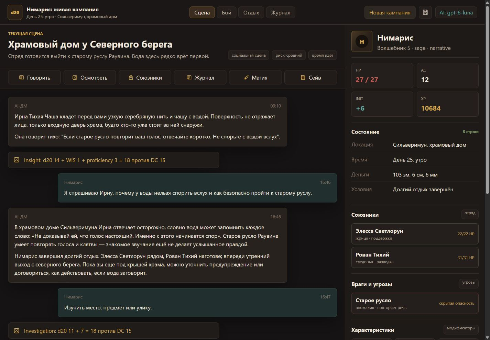

# D&D AI DM UI

Локальная текстовая RPG: чат с AI-мастером, живой лист персонажа, кнопки действий, инвентарь, заклинания, броски и история. Интерфейс на русском; сервер работает только на вашем компьютере.



## Запуск

Нужен Node.js 20 или новее (рекомендуется актуальная LTS).

```sh
npm ci
npm start
```

Откройте <http://127.0.0.1:8788>. На Windows можно запустить `start-game.cmd` из папки проекта. Для другого порта задайте `PORT` в окружении.

## Continue with ChatGPT

1. Нажмите `AI: fallback` в правом верхнем углу.
2. Нажмите **Continue with ChatGPT**. В отдельной вкладке OpenAI войдите в свой аккаунт и разрешите использование плана ChatGPT.
3. После возвращения в игру выберите модель из списка своего аккаунта.
4. Опишите действие героя в чате или нажмите кнопку действия.

Это официальный **Sign in with ChatGPT / ChatGPT plan usage** для локального открытого приложения. Отдельного API-ключа не требуется. Доступность моделей и запросов зависит от аккаунта, подходящего плана и разрешений; расходуется **общий лимит Codex / ChatGPT Work** вашего плана, не отдельный запас приложения. [Пояснение OpenAI](https://learn.chatgpt.com/docs/sign-in-with-chatgpt#use-your-chatgpt-plan). Вход без разрешения `chatgpt.tokens.use.direct` не включает AI. Один вход не даёт доступа к вашим разговорам ChatGPT.

Приложение хранит отдельные регистрации аккаунтов и рабочих пространств, позволяет переключаться между ними и выходить. При повторном входе сохраняется регистрация; новый клиент и host ID каждый раз не создаются. В настройках есть ссылка на управление доступом и лимитами ChatGPT.

- [Регистрация и OAuth](https://developers.openai.com/siwc/token-sharing-open-source/sign-in)
- [Аккаунты, обновление и выход](https://developers.openai.com/siwc/token-sharing-open-source/profiles-and-sessions)
- [Модели и Responses API](https://developers.openai.com/siwc/token-sharing-open-source/models-and-inference)

Токены остаются на сервере и не возвращаются JavaScript-интерфейсу. На Windows хранилище `%LOCALAPPDATA%\DndAiDmUi\accounts.dat` защищено DPAPI текущего пользователя; на Linux/macOS используется `~/.config/dnd-ai-dm-ui/accounts.dat` с правами 0600 в каталоге 0700. Хранилище находится вне Git-проекта. Локальный вход не предназначен для публичного многопользовательского сервера.

## Без ChatGPT

Работают локальные шаблоны и действия движка. Непонятный свободный текст вызывает уточнение. При желании можно настроить существующий API-, OpenRouter-, Ollama- или CLI-адаптер через `.env.local` по `.env.example`. Ключи не вставляйте в код и не публикуйте. Подключённый аккаунт ChatGPT имеет приоритет перед `.env.local`.

## Сохранения и проверки

Сохранение: `data/saves/campaign-alpha.json`. Состояние записывается после успешного действия; параллельные запросы обрабатываются последовательно. Ошибка ChatGPT до завершения хода не сохраняет частичные изменения. `data/private-world-packs/` можно использовать для личных заметок мира. Вся папка `data/` исключена из Git.

```sh
npm run check
npm test
npm run smoke
```

Тесты и smoke используют отдельные временные папки и не сбрасывают вашу игру. `BASE_URL` для smoke предназначен только для отдельного тестового сервера: такой запуск меняет и сбрасывает его кампанию.

Дополнительные переменные: `DND_DATA_DIR` меняет папку сохранений и заметок, `CHATGPT_AUTH_DIR` — защищённого хранилища. Не запускайте несколько процессов с одной папкой сохранений или аккаунтов.

## Границы прототипа

- Упрощённый бой, проверки и ресурсы, без полной реализации D&D 5e/SRD.
- Одна активная кампания; начало новой заменяет текущее сохранение.
- Четыре стартовые сцены. В локальном режиме используются шаблоны; подключённый AI пишет повествование и переводит намерения в доступные действия.
- AI не получает произвольный доступ к файлам или терминалу. Числовые изменения применяет движок.
- Неподдержанные намерения и эффекты не превращаются автоматически в новые механики. Предметы с описанием магического эффекта пока не реализуют этот эффект.
- На 0 HP доступна упрощённая помощь союзников без награды; полноценные спасброски от смерти и рост уровня ещё не реализованы.
- Схематичной карты пока нет. Вкладки интерфейса только переключают просмотр; отдых и появление противника требуют явного игрового действия.
- Автоматические тесты OAuth используют контролируемые ответы провайдера. Реальный вход, доступность аккаунта и первый AI-ответ проверяются отдельно с пользователем.

Результаты проведённой проверки, включая реальные ответы ChatGPT, описаны в [VERIFICATION.md](VERIFICATION.md).

Исходный интерфейс восстановлен из личного архивного прототипа; прежние сохранения, ключи и приватные заметки в репозиторий не включены. MIT распространяется на код проекта; права на упоминаемые сторонние названия и материалы принадлежат их владельцам. Неофициальный независимый проект, не продукт OpenAI или Wizards of the Coast.
