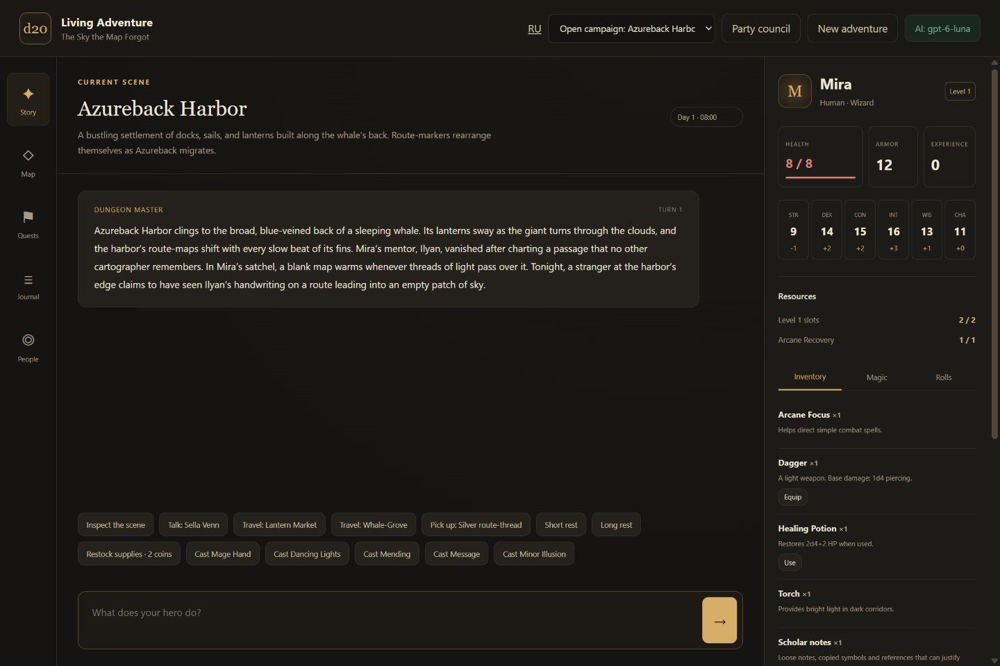

# D&D AI DM UI

Локальная RPG в мире, который придумывают игрок и AI-мастер: история, живой герой, карта, задачи, журнал, персонажи, заклинания и броски. Интерфейс доступен на русском и английском (`/?lang=en`); язык новых историй сохраняется в кампании. Сервер работает только на вашем компьютере.



## Запуск

Нужен Node.js 20 или новее (рекомендуется актуальная LTS).

```sh
npm ci
npm start
```

Откройте <http://127.0.0.1:8788>. На Windows можно запустить `start-game.cmd` из папки проекта. Для другого порта задайте `PORT` в окружении.

## Continue with ChatGPT

1. Нажмите **Подключить AI** в правом верхнем углу.
2. Нажмите **Continue with ChatGPT**. В отдельной вкладке OpenAI войдите в свой аккаунт и разрешите использование плана ChatGPT.
3. После возвращения в игру выберите модель из списка своего аккаунта.
4. Опишите мир и героя, создайте приключение и действуйте через чат или кнопки. Переключение кампаний не удаляет прежние истории.

Это официальный **Sign in with ChatGPT / ChatGPT plan usage** для локального открытого приложения. Отдельного API-ключа не требуется. Доступность моделей и запросов зависит от аккаунта, подходящего плана и разрешений; расходуется **общий лимит Codex / ChatGPT Work** вашего плана, не отдельный запас приложения. [Пояснение OpenAI](https://learn.chatgpt.com/docs/sign-in-with-chatgpt#use-your-chatgpt-plan). Вход без разрешения `chatgpt.tokens.use.direct` не включает AI. Один вход не даёт доступа к вашим разговорам ChatGPT.

Приложение хранит отдельные регистрации аккаунтов и рабочих пространств, позволяет переключаться между ними и выходить. При повторном входе сохраняется регистрация; новый клиент и host ID каждый раз не создаются. В настройках есть ссылка на управление доступом и лимитами ChatGPT.

- [Регистрация и OAuth](https://developers.openai.com/siwc/token-sharing-open-source/sign-in)
- [Аккаунты, обновление и выход](https://developers.openai.com/siwc/token-sharing-open-source/profiles-and-sessions)
- [Модели и Responses API](https://developers.openai.com/siwc/token-sharing-open-source/models-and-inference)

Токены остаются на сервере и не возвращаются JavaScript-интерфейсу. На Windows хранилище `%LOCALAPPDATA%\DndAiDmUi\accounts.dat` защищено DPAPI текущего пользователя; на Linux/macOS используется `~/.config/dnd-ai-dm-ui/accounts.dat` с правами 0600 в каталоге 0700. Хранилище находится вне Git-проекта. Локальный вход не предназначен для публичного многопользовательского сервера.

## Без ChatGPT

Работают локальные шаблоны и действия движка. Непонятный свободный текст вызывает уточнение. При желании можно настроить существующий API-, OpenRouter-, Ollama- или CLI-адаптер через `.env.local` по `.env.example`. Ключи не вставляйте в код и не публикуйте. Подключённый аккаунт ChatGPT имеет приоритет перед `.env.local`.

## Сохранения и проверки

Новые кампании хранятся в SQLite под `data/rules/`, выбранная кампания — в `data/active-adventure.json`. Разрешённое движком действие сохраняется до генерации описания; после ошибки AI описание можно повторить без нового броска или расхода ресурсов. Параллельные запросы обрабатываются последовательно, устаревшие команды отклоняются. Полный журнал и архив диалога остаются локально; AI получает ограниченную выборку. Вся папка `data/` исключена из Git.

Ранняя альфа доступна по `/legacy`; её `data/saves/campaign-alpha.json` сохраняется отдельно.

В журнале можно добавить свою запись и закрепить важное открытие для мастера. Поиск работает по всей истории, старые записи загружаются порциями. Мастер получает подборку до 12 тысяч символов: текущие числа героя, связанные задачи, важные записи и подходящие воспоминания из архива. Записи и закрепления сохраняются без AI-запроса. Панель «Память мастера» показывает размер контекста и учтённые счётчики токенов провайдера. Подробнее: [CAMPAIGN_MEMORY.md](CAMPAIGN_MEMORY.md).

В режиме «Вопрос мастеру» можно уточнять правила, текущую ситуацию и прошлые события. Ответ использует один AI-запрос и сохраняет время, ход и ресурсы героя. Обычный режим «Действие героя» разрешает игровые намерения через правила.

```sh
npm run check
npm test
npm run smoke
```

Тесты и smoke используют отдельные временные папки и не сбрасывают вашу игру. `BASE_URL` для smoke предназначен только для отдельного тестового сервера: такой запуск меняет и сбрасывает его кампанию.

Дополнительные переменные: `DND_DATA_DIR` меняет папку сохранений и заметок, `CHATGPT_AUTH_DIR` — защищённого хранилища. Не запускайте несколько процессов с одной папкой сохранений или аккаунтов.

## Границы прототипа

- В разделе «Отряд» можно пригласить подходящего NPC, отпустить и снова встретить его с сохранёнными HP, вещами и ресурсами. Спутники следуют за героем и выполняют реальные автоматические боевые ходы; основные лечебные и одиночные заклинания используют их собственные ячейки. Подробности и ограничения: [COMPANIONS.md](COMPANIONS.md).
- В «Совете» и «Разговоре в сцене» персонажи говорят отдельными карточками. Можно показать следующую реплику, вклиниться, принять или отклонить предложение. После вмешательства кнопка «Ответ персонажей» получает одну новую партию реплик; остальные показываются без AI-запроса. Речь не выполняет игровые действия за игрока. См. [DIALOGUE_AND_COOP.md](DIALOGUE_AND_COOP.md).
- Основа SRD 5.1: классы, происхождения, проверки, инициатива, бой, отдых и рост героя. Полное соответствие всем правилам и длительная игра ещё проверяются.
- AI создаёт оригинальную связанную карту, персонажей, предметы, задачи и проверки. Без AI используются стартовые шаблоны.
- AI не получает произвольный доступ к файлам или терминалу. Числовые изменения применяет движок.
- Оригинальные заклинания используют проверяемые составные эффекты. Не любой выдуманный эффект уже поддержан. Генерируемые находки и награды могут быть оружием, лечением, временной защитой или бонусом проверки; AI задаёт образ и тип, движок ограничивает силу и редкость. После победы добыча остаётся в месте боя и забирается явно. Карточки показывают свойства, редкость и источник; повтор команды не дублирует предметы.
- В главной кампании игрок явно завершает боевой ход: обычное действие не отнимает оставшееся бонусное. Применение вещи в бою расходует доступное действие, защитные расходники можно подготовить и вне боя. Есть прогресс опыта и записи повышения уровня.
- Во вкладке «Поселение» работают рынки, продажа свободных вещей, конечные запасы и деньги торговца, ночлег, лекарь, платные сведения и транспорт. Дефицит и помощь местным меняют условия; сделки сохраняются без отдельного AI-запроса. Защищены предметы задач и экипировка. Подробности и границы: [LOOT_AND_ECONOMY.md](LOOT_AND_ECONOMY.md).
- Припасы и истощение включаются при создании кампании. Погода и более глубокие социальные последствия ещё в разработке.
- Карта, задачи, журнал и лист героя читают общее состояние. Кнопки отдыха, перемещения и действия меняют его явно.
- Свои картинки сцен/героев/NPC доступны через галерею; генератор требует отдельной настройки. Сетевой кооператив пока не подключён.
- Автоматические тесты OAuth используют контролируемые ответы провайдера. Реальный вход, доступность аккаунта и первый AI-ответ проверяются отдельно с пользователем.

Результаты проведённой проверки, включая реальные ответы ChatGPT, описаны в [VERIFICATION.md](VERIFICATION.md).

## Развитие живого приключения

Продолжается переход от исходной альфы к свободному приключению с общей механикой D&D. Текущая основа и незавершённые требования перечислены в [DEVELOPMENT.md](DEVELOPMENT.md).

Очередь этапов, текущая стадия и критерии готовности собраны в [ROADMAP.md](ROADMAP.md).

- Подключён независимый снимок ядра SRD: 12 основ классов, 9 основ происхождения, реальные броски, отдых и сохранение кампаний в SQLite. Главный экран использует это состояние через `/api/adventure/*`.
- Новые заклинания описываются проверяемыми эффектами, а не только ссылками на готовый каталог. Генерируемые эффекты проходят проверки силы и ресурсов. Нет исполнения произвольного кода модели.
- Полный локальный журнал и архив диалога сохраняются; модель получает ограниченный контекст с выборкой связанных фактов и активных задач. Есть тест на 400 ходов и возврат старой зацепки.
- Подготовлены проверки сцен и диалогов: результат может открыть новый факт, а повторный вход не перебрасывает уже сделанную проверку.
- Добавлена панель «Обсудить с отрядом»: несколько говорящих, вмешательство игрока и принятие/отклонение предложения. Один короткий диалог генерируется одним запросом.
- [Диалоги и возможный кооператив](DIALOGUE_AND_COOP.md): изучены OpenMAIC и текущие границы ядра. Мультиплеер ещё не реализован; публичный сетевой доступ не включён.

Атрибуция импортированного ядра и SRD находится в [vendor/dnd-core/PROVENANCE.md](vendor/dnd-core/PROVENANCE.md).

Исходный интерфейс восстановлен из личного архивного прототипа; прежние сохранения, ключи и приватные заметки в репозиторий не включены. MIT распространяется на код проекта; права на упоминаемые сторонние названия и материалы принадлежат их владельцам. Неофициальный независимый проект, не продукт OpenAI или Wizards of the Coast.

Quest mechanics, delivery evidence and alternative checks: [QUESTS.md](QUESTS.md).

Optional artwork, local uploads and separately configured generation: [ARTWORK.md](ARTWORK.md).

Class progression, combat casting and verification limits: [CLASS_AND_COMBAT.md](CLASS_AND_COMBAT.md).

General physical scene actions and their present limits: [ENVIRONMENT_INTERACTIONS_DESIGN.md](ENVIRONMENT_INTERACTIONS_DESIGN.md). Ordinary noncombat narration can open a multi-speaker scene conversation with interruption, player intervention and accepted/rejected proposals. The story, character/inventory, map and tasks are separate views; journal/party/settlement/art use More.

Persistent NPC battles, fixed profiles and durable wounds: [NPC_COMBAT.md](NPC_COMBAT.md). Their ordinary attacks and catalog spells share initiative/action resources; a civilian conflict does not invent treasure or location-quest rewards.

Social checks, relationships, restitution and the memory of player claims: [SOCIAL_MECHANICS.md](SOCIAL_MECHANICS.md). Speech can change real NPC attitudes; payment and repeated attempts are guarded independently of narration. Detailed relationship controls are collapsed in NPC cards.
